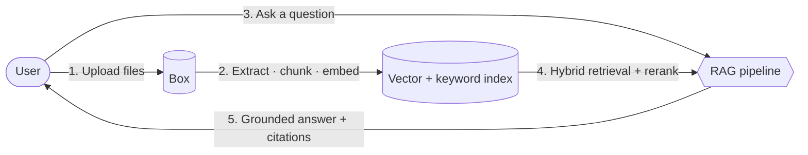
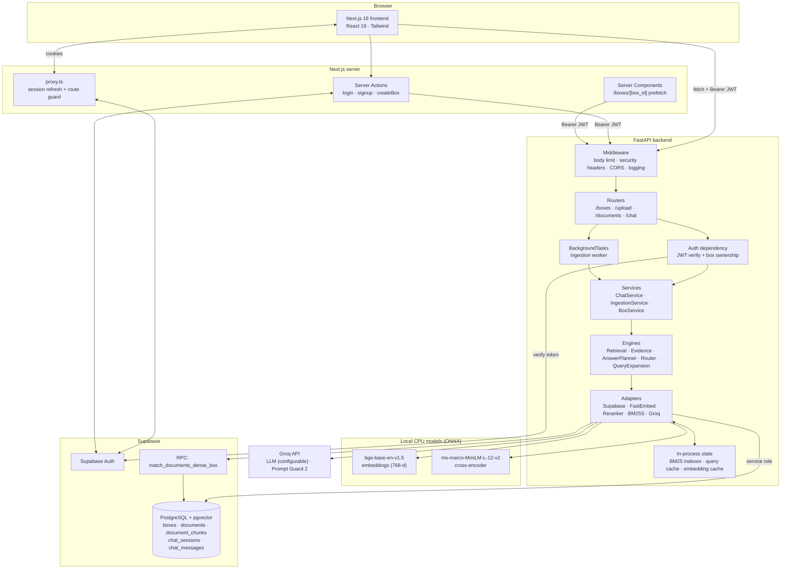
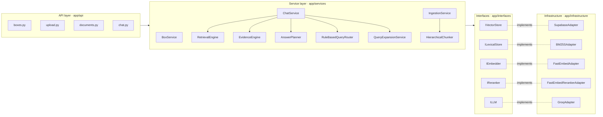
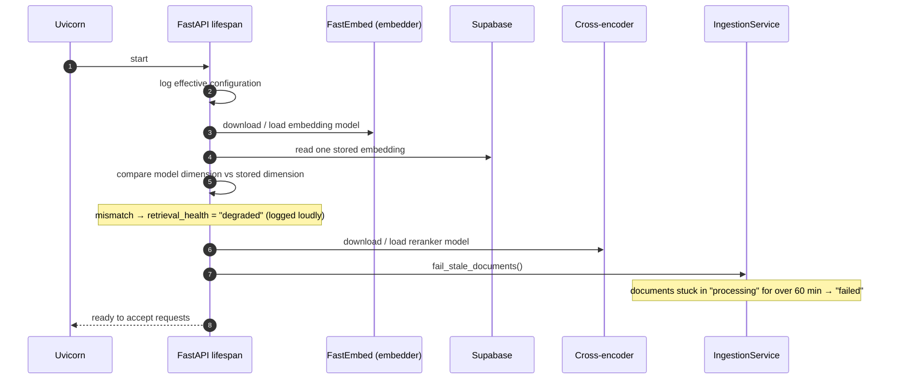
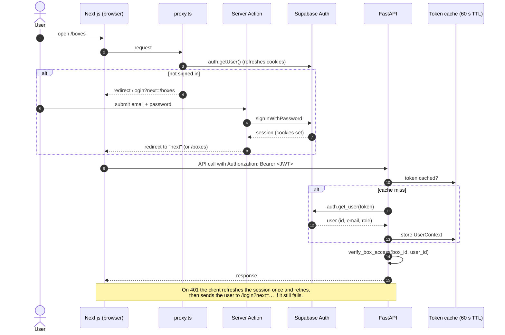
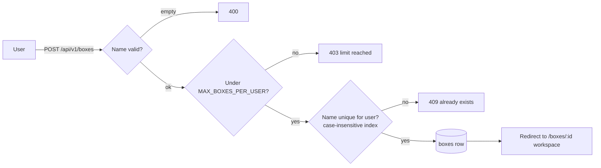
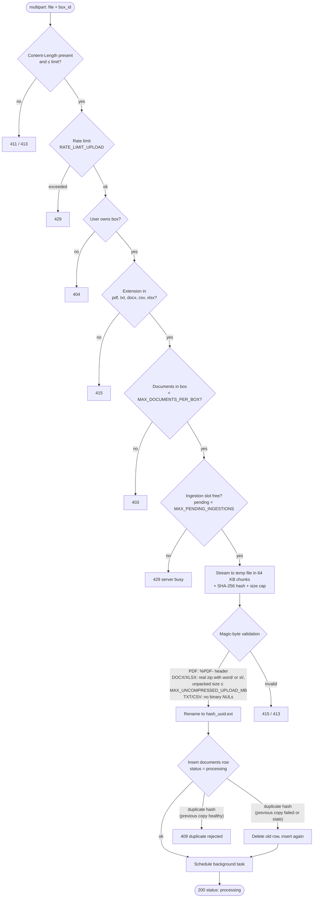
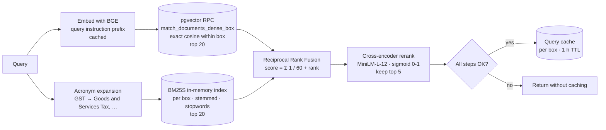
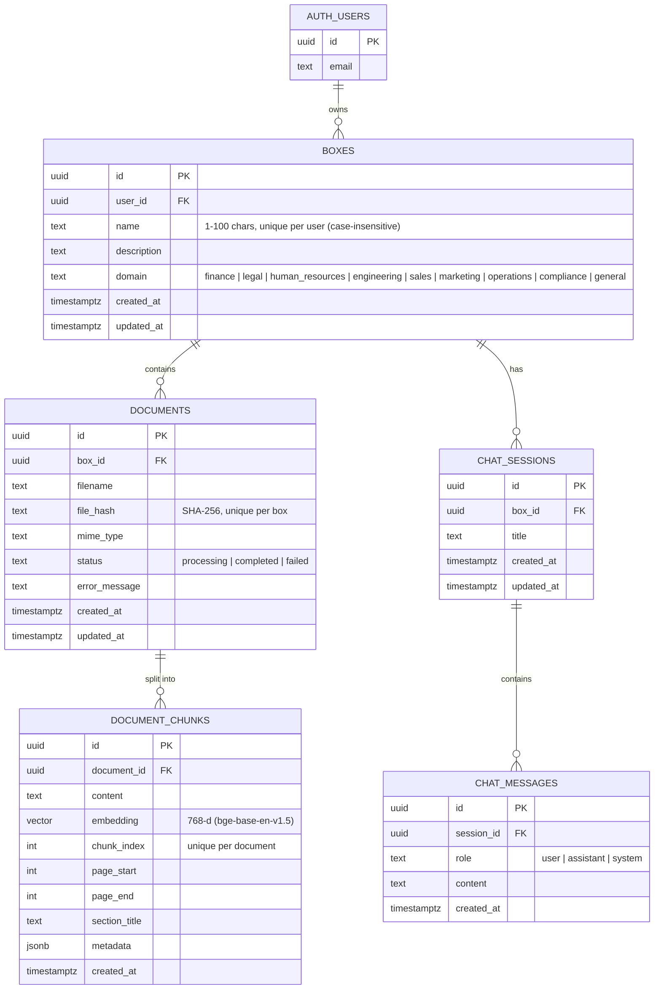

<div align="center">

# DocIntel

**An anti-hallucination knowledge agent for your private documents.**

Upload PDFs, Word files, spreadsheets and text files into private *Boxes*, then ask questions in plain language.
Every answer is grounded in retrieved passages and carries clickable citations back to the exact source.


</div>

---

## Table of Contents

1. [Overview](#1-overview)
2. [Key Features](#2-key-features)
3. [Technology Stack](#3-technology-stack)
4. [System Architecture](#4-system-architecture)
5. [Repository Structure](#5-repository-structure)
6. [Core Workflows](#6-core-workflows)
   - [6.1 Authentication](#61-authentication-workflow)
   - [6.2 Box Management](#62-box-management-workflow)
   - [6.3 Document Upload & Ingestion](#63-document-upload--ingestion-workflow)
   - [6.4 Question Answering (RAG Pipeline)](#64-question-answering-workflow-rag-pipeline)
   - [6.5 Hybrid Retrieval in Detail](#65-hybrid-retrieval-in-detail)
   - [6.6 Citation Firewall](#66-citation-firewall)
7. [Data Model](#7-data-model)
8. [API Reference](#8-api-reference)
9. [Configuration Reference](#9-configuration-reference)
10. [Getting Started](#10-getting-started)
11. [Testing](#11-testing)
12. [Utility Scripts](#12-utility-scripts)
13. [Deployment Notes](#13-deployment-notes)
14. [Security Model](#14-security-model)
15. [Resilience & Performance](#15-resilience--performance)
16. [Known Limitations & Roadmap](#16-known-limitations--roadmap)
17. [Troubleshooting](#17-troubleshooting)

---

## 1. Overview

DocIntel is a full-stack **Retrieval-Augmented Generation (RAG)** application. Its main design goal is to **never invent an answer**:

- It retrieves evidence with **hybrid search**: dense vector search plus BM25 keyword search, fused with Reciprocal Rank Fusion and reranked by a cross-encoder.
- It refuses to answer when the evidence is too weak, and shows the closest matching passages instead.
- It runs every generated answer through a **citation firewall** that checks citation IDs, numbers and sentence-level support before the answer reaches the user.

Documents are organised into **Boxes**: private, per-user collections (for example *"Q4 acquisition due diligence"* or *"HR policies"*). Each question is answered only from the documents in the current box.

### How it works, in one picture



---

## 2. Key Features

| Area | Feature |
|---|---|
| **Workspaces** | Private *Boxes* with name, description and business domain (finance, legal, HR, engineering, sales, marketing, operations, compliance, general). |
| **File support** | PDF, DOCX, TXT, CSV, XLSX, up to 25 MB each (configurable). |
| **Structure-aware ingestion** | PDF column-aware reading order, TOC/heading section detection, page-range tracking; DOCX headings, tables, text boxes, tracked insertions, footnotes/headers/footers; per-sheet XLSX parsing; row-preserving CSV chunking. |
| **Hierarchical chunking** | Logical parent sections with embedding-sized child chunks, so neighbour expansion stays inside the same section. |
| **Hybrid retrieval** | pgvector cosine search + in-memory BM25S keyword search → Reciprocal Rank Fusion → local cross-encoder reranker. |
| **Query intelligence** | Rule-based follow-up detection, LLM query rewriting with paraphrase variants, multi-part question splitting, question-type-aware answer formatting (tables for comparisons, numbered lists for processes, and so on). |
| **Anti-hallucination** | Relevance gates, a rescue retrieval pass, a fixed fallback phrase, evidence-ID validation, number verification, cross-encoder sentence support scoring, one self-correction retry. |
| **Citations UI** | Inline `[E1]` markers rendered as clickable chips that open the exact source passage with filename, page range and section. |
| **Conversations** | Persistent chat sessions per box: create, rename, delete, reload history. |
| **Security** | Supabase Auth (JWT), per-box ownership checks, Postgres Row-Level Security, Prompt Guard injection screening, magic-byte file validation, zip-bomb guard, strict CSP and security headers, per-user rate limiting and quotas. |
| **Operations** | Health endpoint with retrieval-degradation status, boot-time embedding-dimension check, stale-ingestion sweeper, structured timing and audit logs. |
| **Cost** | Embeddings and reranking run locally on CPU (ONNX via FastEmbed). Only generation calls the Groq API, so the whole stack can run on free tiers. |

---

## 3. Technology Stack

### Backend (`/backend`)

| Concern | Technology |
|---|---|
| Web framework | **FastAPI** 0.143 on **Uvicorn**, Starlette threadpools for blocking I/O |
| Configuration | **pydantic-settings** (type-safe, `.env`-driven) |
| Database & Auth | **Supabase** (PostgreSQL + **pgvector** + Supabase Auth) via `supabase-py` |
| LLM | **Groq** API: model configurable via `LLM_MODEL_NAME` in `.env`; `meta-llama/llama-prompt-guard-2-86m` for injection screening |
| Embeddings | **FastEmbed** (ONNX, local CPU): `BAAI/bge-base-en-v1.5`, 768 dimensions |
| Reranker | **FastEmbed TextCrossEncoder**: `Xenova/ms-marco-MiniLM-L-12-v2` |
| Keyword search | **bm25s** with **py_rust_stemmers** (Snowball English stemmer) |
| Text splitting | **langchain-text-splitters** `RecursiveCharacterTextSplitter` |
| Parsers | **PyMuPDF** (PDF), **python-docx** + **lxml** (DOCX), **openpyxl** (XLSX), stdlib `csv` |
| Resilience | **tenacity** (exponential backoff), **slowapi** (rate limiting), **cachetools** |
| Logging | **loguru** |

### Frontend (`/frontend`)

| Concern | Technology |
|---|---|
| Framework | **Next.js 16** (App Router, Server Components, Server Actions) |
| UI | **React 19**, **Tailwind CSS 4**, **lucide-react** icons |
| Auth | **@supabase/ssr** + **@supabase/supabase-js** (cookie-based sessions) |
| Markdown | **react-markdown** + **remark-gfm** (tables, lists, citation links) |
| Language | **TypeScript 5** |

### Infrastructure (free-tier friendly)

| Layer | Suggested host |
|---|---|
| Frontend | Vercel |
| Backend | Railway (or any container/VM host with about 2 GB RAM for the local models) |
| Database / Auth | Supabase |
| LLM | Groq |

---

## 4. System Architecture

### 4.1 High-level architecture



### 4.2 Backend layered design (ports and adapters)

The backend follows a **clean, dependency-injected architecture**. Services depend only on abstract interfaces. Concrete adapters are wired in **one place**, [`app/core/dependencies.py`](backend/app/core/dependencies.py), so a model or provider can be swapped by editing `.env` or one adapter class.



| Layer | Responsibility |
|---|---|
| **API** (`app/api`) | HTTP contracts (Pydantic models), auth and ownership checks, rate limits, HTTP error mapping. No business logic. |
| **Core** (`app/core`) | Settings, dependency injection, auth, rate limiter, caches, retrieval-health signal, logger. |
| **Services** (`app/services`) | Business logic: ingestion, retrieval, evidence gating, answer planning, chat orchestration. |
| **Interfaces** (`app/interfaces`) | Abstract base classes (ports) the services depend on. |
| **Infrastructure** (`app/infrastructure`) | Concrete adapters for Supabase, BM25S, FastEmbed, the cross-encoder and Groq. |
| **Utils** (`app/utils`) | Pure helpers: column-aware PDF block sorting, citation and answer-structure parsing. |

### 4.3 Request middleware chain

Every request to the backend passes through, in order:

1. **CORS**: only origins listed in `CORS_ORIGINS`. Credentials are disabled automatically if a wildcard is used.
2. **Request logging**: method, URL and a safe subset of headers. High-frequency polling endpoints are excluded.
3. **Security headers**: `X-Content-Type-Options`, `X-Frame-Options: DENY`, `Referrer-Policy: no-referrer`, HSTS, `Cache-Control: no-store`, and `Content-Security-Policy: default-src 'none'` on all API routes.
4. **Upload body limit**: `POST /api/v1/upload*` must send `Content-Length` (otherwise **411**) and must stay under `MAX_UPLOAD_SIZE_MB` + 1 MB (otherwise **413**). The check runs *before* the body is read.
5. **Rate limiter** (slowapi): keyed **per authenticated user** (JWT `sub`) instead of per IP, so users behind a shared proxy are not throttled together.
6. **Global exception handlers**: validation errors return **422** with details; unhandled errors are logged with a traceback and return a generic **500**, so internals never leak.

### 4.4 Application lifecycle (startup)



---

## 5. Repository Structure

```text
├── README.md                     ← you are here
├── .env.template                 ← environment template (copy to backend/.env)
│
├── backend/                      ← FastAPI service
│   ├── main.py                   ← app factory, middleware, lifespan, health route
│   ├── requirements.txt
│   ├── app/
│   │   ├── api/                  ← HTTP routers
│   │   │   ├── boxes.py          ← Box CRUD
│   │   │   ├── upload.py         ← streaming upload, validation, backpressure, background ingestion
│   │   │   ├── documents.py      ← list / delete documents, stale detection
│   │   │   └── chat.py           ← sessions CRUD, Prompt Guard, Q&A endpoint
│   │   ├── core/
│   │   │   ├── config.py         ← all settings (pydantic-settings)
│   │   │   ├── dependencies.py   ← DI container (singleton adapters, service factories)
│   │   │   ├── auth.py           ← Supabase JWT verification (60 s TTL cache), box ownership
│   │   │   ├── rate_limiter.py   ← per-user slowapi limiter
│   │   │   ├── cache.py          ← thread-safe LRU+TTL caches (embeddings, query results)
│   │   │   ├── retrieval_health.py ← process-wide dense-search health signal
│   │   │   └── logger.py
│   │   ├── interfaces/           ← abstract ports: IVectorStore, ILexicalStore, IEmbedder, IReranker, ILLM
│   │   ├── infrastructure/       ← adapters: Supabase, BM25S, FastEmbed, reranker, Groq
│   │   ├── services/
│   │   │   ├── chat_service.py         ← end-to-end RAG orchestration + citation firewall
│   │   │   ├── retrieval_engine.py     ← dense + BM25 → RRF → rerank, cached per box
│   │   │   ├── evidence_engine.py      ← relevance gate, neighbour expansion, confidence, context builder
│   │   │   ├── answer_planner.py       ← question typing and multi-part splitting (no LLM)
│   │   │   ├── query_router.py         ← rule-based follow-up detection
│   │   │   ├── query_expansion.py      ← one LLM call: standalone rewrite + variants
│   │   │   ├── ingestion_service.py    ← extraction, chunking, embedding, persistence
│   │   │   ├── hierarchical_chunking.py← parent sections → child chunks
│   │   │   └── box_service.py
│   │   └── utils/
│   │       ├── pdf_parser.py           ← column-aware reading order for PDF blocks
│   │       └── citation_validator.py   ← sentence/claim parsing, number checks, answer cleanup
│   ├── schema_phase1b.sql        ← base schema: tables, indexes, RLS policies
│   ├── schema_phase1c_domain.sql ← adds boxes.domain
│   ├── schema_phase1e_dense.sql  ← dense search RPC (superseded by migrations below)
│   ├── migrations/               ← ordered, idempotent migrations (run after the schema files)
│   ├── scripts/                  ← benchmark, re-ingest, dry-run and debugging tools
│   └── tests/                    ← 27 pytest modules
│
└── frontend/                     ← Next.js 16 application
    ├── next.config.ts            ← CSP and security headers
    └── src/
        ├── proxy.ts              ← Next 16 "proxy" (formerly middleware): session refresh + route guard
        ├── app/
        │   ├── page.tsx          ← marketing / landing page
        │   ├── login/, signup/   ← auth pages
        │   ├── auth/             ← server actions, OAuth/email callback, logout
        │   ├── onboarding/       ← create your first box
        │   ├── boxes/            ← dashboard, "all boxes", per-box workspace
        │   ├── workspace/chat/ChatDashboard.tsx ← chat + documents + citations UI
        │   ├── settings/         ← profile settings
        │   └── knowledge-base/   ← "coming soon" placeholder
        ├── components/           ← auth shell, dialogs, layout shell, upload modal, toasts, brand
        └── lib/
            ├── api.ts            ← apiFetch: JWT injection, 401 refresh-and-retry, timeouts, error mapping
            ├── config.ts         ← API_URL
            ├── supabase/         ← browser, server and proxy Supabase clients
            └── boxDomains.ts, types.ts, useClientState.ts, authMessages.ts
```

---

## 6. Core Workflows

### 6.1 Authentication workflow

Authentication is handled by **Supabase Auth**. The frontend keeps the session in HTTP cookies (`@supabase/ssr`). The backend never trusts the token by itself; it verifies every token with Supabase.



**Route protection (frontend).** `proxy.ts` guards `/boxes`, `/onboarding`, `/settings`, `/knowledge-base` and `/workspace`. Unauthenticated users are redirected to `/login?next=<original path>`. Signed-in users who open `/login` or `/signup` are redirected to `/boxes`.

**Sign-up.** Passwords are checked for confirmation and strength. If email confirmation is on, the user sees a "check your email" message, and the confirmation link lands on `/auth/callback`, which exchanges the code for a session.

### 6.2 Box management workflow



- **List / get** returns each box with its document count (`documents(count)`).
- **Update** (`PATCH`) accepts `name`, `description` and `domain` (limited to the nine supported domains).
- **Delete** cascades in Postgres to documents → chunks, and to chat sessions → messages. It also drops the box's in-memory BM25 index.

### 6.3 Document upload & ingestion workflow

Ingestion has two phases. A **synchronous upload phase** validates the file and returns at once with `status: processing`. An **asynchronous background phase** extracts, chunks, embeds and stores the content. The frontend polls the document list every 3 seconds to show progress.

#### Phase 1: Upload (synchronous, `POST /api/v1/upload/box`)



#### Phase 2: Background ingestion

```mermaid
flowchart TD
    BG([Background task]) --> SEM[Acquire semaphore<br/>MAX_CONCURRENT_INGESTIONS]
    SEM --> T{File type}

    T -- PDF --> P1[Open with PyMuPDF]
    P1 --> P2[Read TOC → page-to-section map]
    P2 --> P3[For each batch of 20 pages]
    P3 --> P4[Extract text blocks<br/>column-aware sort<br/>strip bidi / invisible chars<br/>normalise text]
    P4 --> P5[Detect section titles when no TOC<br/>uppercase or numbered headings]
    P5 --> P6[RecursiveCharacterTextSplitter<br/>1400 chars / 200 overlap<br/>heading-aware separators]
    P6 --> P7[Merge tiny chunks under 200 chars<br/>map each chunk to page_start / page_end]
    P7 --> EMB

    T -- DOCX --> D1[Walk body, text boxes, tracked insertions<br/>Headings → markdown ##<br/>Tables → pipe rows<br/>Notes, headers, footers]
    D1 --> D2{≥ 98% of visible chars extracted?}
    D2 -- no --> FAIL
    D2 -- yes --> H
    T -- XLSX --> X1[Per sheet: '--- Sheet: name ---'<br/>rows as 'Header: value | …'<br/>reject formulas without cached values]
    X1 --> H
    T -- CSV --> C1[Rows as 'Column: value | …']
    C1 --> H
    T -- TXT --> TX1[Decode UTF-16 BOM → UTF-8 → cp1252<br/>numbered lines become headings]
    TX1 --> H

    H[HierarchicalChunker<br/>parent sections → child chunks<br/>row-preserving for tabular data] --> EMB

    EMB[Embed in batches of INGESTION_BATCH_SIZE<br/>text = '[Document: file | Section: s]' + chunk] --> UPS[Upsert into document_chunks<br/>on conflict document_id, chunk_index<br/>3 attempts per batch]
    UPS -- FK violation --> DEL[Document deleted by user → abort quietly]
    UPS --> VER{Stored chunk count<br/>= expected?}
    VER -- yes --> OK[status = completed<br/>invalidate BM25 index + query cache]
    VER -- no --> FAIL[Delete partial chunks<br/>status = failed + user-safe message]
    OK --> CLEAN[Remove temp file · release slot]
    FAIL --> CLEAN
```

**Chunk metadata stored with every child chunk**

| Field | Purpose |
|---|---|
| `chunk_index` | Global, gap-free order within a document (used for neighbour expansion). |
| `page_start`, `page_end` | PDF page range, shown in citations. |
| `section_title` | Detected heading, sheet name or TOC entry. |
| `metadata.context_header` | `[Document: … \| Type: … \| Pages/Section … \| Chunk n]`, given to the reranker and shown in the UI. |
| `metadata.parent_id`, `parent_title`, `section_path` | The logical parent section, so expansion only pulls **siblings**. |
| `metadata.block_type` | `section`, `spreadsheet_rows` or `table_rows`. |

**Failure handling**

| Situation | Result shown to the user |
|---|---|
| Scanned or image-only PDF with no text | "No extractable text… requires OCR" |
| Unrecognised text encoding | "Save it as UTF-8 and upload it again" |
| XLSX formulas without saved values | "Open the file in Excel, save it, and upload it again" |
| Some batches failed | "Some parts of this document could not be processed…" |
| Server restarted during ingestion | Marked failed after `STALE_PROCESSING_MINUTES`; re-uploading the same file is allowed |

### 6.4 Question answering workflow (RAG pipeline)

`POST /api/v1/chat/` runs the full pipeline in [`ChatService.ask_question`](backend/app/services/chat_service.py).

```mermaid
flowchart TD
    Q([Question + box_id + session_id]) --> G0{Rate limit · box ownership}
    G0 --> G1{Prompt Guard 2<br/>injection score > 0.5?}
    G1 -- yes --> BLK[400 blocked]
    G1 -- "no (fails open on error)" --> G2{Session belongs to box?}
    G2 -- no --> NF[404]
    G2 -- yes --> S1[Save user message]
    S1 --> S2[Load history · keep last 8 messages]
    S2 --> S3{Rule-based router}
    S3 -- "follow_up<br/>(≤ 3 words, 'what about…',<br/>pronouns like it / they / this)" --> S4[QueryExpansion: 1 LLM call<br/>standalone rewrite + up to 3 variants]
    S3 -- normal --> S5
    S4 --> S5[AnswerPlanner<br/>type: factual · definition · comparison · process ·<br/>pros_cons · summary · multi_part · comprehensive<br/>split into up to 4 parts]
    S5 --> S6{Multi-part?}
    S6 -- yes --> S7[One hybrid retrieval per part + whole question<br/>round-robin merge, max 10 chunks]
    S6 -- no --> S8[Single hybrid retrieval]
    S7 --> E1
    S8 --> E1[EvidenceEngine<br/>relevance filter ≥ MIN_RELEVANCE_SCORE<br/>relax to LOW if under 2 survive<br/>sibling neighbour expansion and merge]
    E1 --> E2{Top score ≥<br/>ANSWER_MIN_RELEVANCE_SCORE?}
    E2 -- no --> R1[Rescue pass<br/>expand query if not done yet<br/>multi-query RRF + rerank]
    R1 --> E3{Top score ≥ threshold?}
    E3 -- no --> FB[Return FALLBACK_PHRASE<br/>+ top 3 closest matches<br/>confidence = low]
    E2 -- yes --> C1
    E3 -- yes --> C1[Assign evidence IDs E1…En<br/>build CONTEXT blocks with<br/>source, pages, section, relevance]
    C1 --> C2[System prompt<br/>format guide for question type<br/>requested parts checklist<br/>citation rules]
    C2 --> L1[Groq LLM · temperature 0<br/>history + question]
    L1 --> F1[Citation firewall]
    F1 --> F2{Any valid citations?}
    F2 -- no --> RT1[Retry once: 'cite evidence IDs']
    RT1 --> F1b[Citation firewall]
    F2 -- yes --> F3{Every part covered and<br/>structure matches type?}
    F3 -- no --> RT2[Retry once: fix gaps<br/>keep only if still cited]
    F3 -- yes --> OUT
    RT2 --> OUT
    F1b --> OUT{Citations remain?}
    OUT -- no --> FB2[Answer = FALLBACK_PHRASE]
    OUT -- yes --> SAVE
    FB2 --> SAVE[Save assistant message]
    SAVE --> RESP([answer · citations · confidence · validation_metadata])
```



**Confidence levels** (from [`EvidenceEngine.determine_confidence`](backend/app/services/evidence_engine.py))

| Confidence | Rule |
|---|---|
| `multi_source` | 3 or more distinct documents, top score ≥ 0.5, score spread > 0.3 |
| `high` | top relevance ≥ 0.7 |
| `medium` | top relevance ≥ 0.3 |
| `low` | anything lower, or no valid citations |

**Answer formats by question type** (from [`answer_planner.py`](backend/app/services/answer_planner.py))

| Type | Triggered by | Format the model is asked for |
|---|---|---|
| `factual` | default | One or two direct sentences, no headings |
| `definition` | "define…", "what is a…", "meaning of…" | Definition → key characteristics → examples |
| `comparison` | "compare", "vs", "difference between" | Markdown table, criteria × items, citation in every cell |
| `process` | "steps", "procedure", "how to/do/does…" | Numbered list in logical order |
| `pros_cons` | "advantages", "pros and cons", "drawbacks" | *Advantages* / *Disadvantages* headings with bullets |
| `summary` | "summarise", "overview", "key points" | Main ideas in source order |
| `multi_part` | enumerations, several `?`, joined asks | One numbered heading per part |
| `comprehensive` | "in detail", "elaborate", "discuss" | Overview → grouped headings → brief conclusion |

**Response shape**

```json
{
  "answer": "The notice period is 30 days [E1] …",
  "citations": [
    {
      "evidence_id": "[E1]",
      "document_id": "…",
      "filename": "HR_Policy.pdf",
      "chunk_index": 42,
      "page_start": 12,
      "page_end": 13,
      "section_title": "Resignation",
      "content": "…source passage…",
      "rerank_score": 0.91
    }
  ],
  "closest_matches": [],
  "session_id": "…",
  "confidence": "high",
  "validation_metadata": {
    "unsupported_sentences": [],
    "stripped_citations": [],
    "retried": false
  }
}
```

### 6.5 Hybrid retrieval in detail

[`RetrievalEngine`](backend/app/services/retrieval_engine.py) combines two retrievers that are good at different things: **dense** search catches meaning and paraphrase, **BM25** catches exact terms, codes and names.



Key details:

- **Exact per-box vector search.** The `match_documents_dense_box` RPC first selects the box's *completed* chunks (a `MATERIALIZED` CTE), then ranks them by cosine distance. This avoids a global approximate HNSW scan that could return few or no hits for small boxes.
- **BM25 index freshness.** Each box's BM25 index lives in memory and is built from Supabase when first needed. Every 30 s (`LEXICAL_INDEX_FRESHNESS_SECONDS`) it is checked against a cheap fingerprint (completed-chunk count + newest `created_at`) and rebuilt if anything changed. This also picks up changes made by other workers or scripts.
- **One relevance scale.** The cross-encoder score (0–1) is authoritative. If reranking fails, cosine similarity is rescaled with `EMBEDDING_SCORE_FLOOR` (0.5 → 0, 1.0 → 1) so the same thresholds still apply. Keyword-only hits score 0, so they never pass a gate without semantic support.
- **Graceful degradation.** If dense search fails, retrieval continues on keywords only, and `retrieval_health` reports `"degraded"` on the health endpoint. Degraded results are never cached.
- **Rescue pass.** `retrieve_documents_multi` runs the rewritten query plus its variants and fuses *all* ranked lists with RRF, so chunks that several phrasings agree on rise to the top.

### 6.6 Citation firewall

Implemented in `ChatService._validate_and_build_citations` and [`utils/citation_validator.py`](backend/app/utils/citation_validator.py). It runs on every LLM answer:

1. **Clean up.** Remove leaked "checklist / reasoning" sections. Rewrite claims like "the document does not mention X" to "the retrieved sections do not cover X", because retrieval never reads a whole document.
2. **Normalise citation markers.** Variants such as `【E1】`, `[E1:p140]` and `【E1†L1-L2】` become `[E1]`.
3. **Remove invented IDs.** Any `[E#]` not present in the context is stripped.
4. **Check each claim, line by line.** Markdown structure is preserved: headings, lists and table rows (a table row counts as one claim).
   - A factual sentence with **no valid citation** is marked *unsupported*.
   - **Every number** in a claim must appear in the cited chunk(s), after normalisation.
   - **Semantic support:** each (claim, cited chunk) pair is scored by the cross-encoder. Below `CITATION_SUPPORT_THRESHOLD` (0.3) the claim is marked *unsupported*.
5. **Enforcement mode.**
   - `soft` (default): unsupported claims are reported in `validation_metadata` but kept.
   - `strict`: unsupported claims and their citations are removed from the answer.
6. **Build citation objects** only for evidence IDs that survive in the final text.

---

## 7. Data Model



- All foreign keys use **`ON DELETE CASCADE`**. Deleting a user removes their boxes, and deleting a box removes everything under it.
- **Row-Level Security** is enabled on every table. Policies tie each row to `auth.uid()` through the box ownership chain.
- **Indexes:** a unique `(user_id, lower(btrim(name)))` on boxes; a unique `(box_id, file_hash)` on documents; `(document_id, chunk_index)` and an HNSW cosine index on chunks; `(box_id, status)` on documents; `session_id` on chat messages.
- **RPC:** `match_documents_dense_box(query_embedding vector, match_box_id uuid, match_count int)` can be executed **only by `service_role`**.

### Schema files and migrations (apply in this order)

| # | File | What it does |
|---|---|---|
| 1 | `backend/schema_phase1b.sql` | Extensions (`uuid-ossp`, `vector`), all tables, indexes, RLS policies, original hybrid RPC |
| 2 | `backend/schema_phase1c_domain.sql` | Adds `boxes.domain` with a CHECK constraint |
| 3 | `backend/schema_phase1e_dense.sql` | Dense-search RPC (optional; replaced by #4 and #7) |
| 4 | `backend/migrations/20261010_switch_to_bge_base_768.sql` | **Truncates chunks**, switches the embedding column to `vector(768)`, rebuilds HNSW and RPCs |
| 5 | `backend/migrations/20261011_drop_unused_objects.sql` | Drops the unused hybrid RPC, tsvector pipeline, `summary` column and chunk-swap helper |
| 6 | `backend/migrations/20261012_security_hardening.sql` | Locks the RPC to `service_role`; blocks self-inserted `system` chat rows |
| 7 | `backend/migrations/20261013_exact_box_dense_search.sql` | Exact per-box dense search, dimension-agnostic signature, `(box_id, status)` index |

> **Warning:** migration #4 runs `TRUNCATE document_chunks`. On an existing database, re-upload or re-ingest your documents after running it.

---

## 8. API Reference

Base URL: `http://localhost:8000`. Every `/api/v1/*` route needs `Authorization: Bearer <Supabase access token>`.
Interactive docs (`/docs`, `/redoc`, `/openapi.json`) are available only when `ENABLE_API_DOCS=true`.

### Health

| Method | Path | Description |
|---|---|---|
| `GET` | `/` | `{ status, version, model, retrieval: ok \| degraded \| unknown, message }` |

### Boxes (`/api/v1/boxes`)

| Method | Path | Body / Query | Rate limit | Description |
|---|---|---|---|---|
| `POST` | `/api/v1/boxes/` | `{ name, description?, domain? }` | `RATE_LIMIT_WRITE` | Create a box (409 duplicate name, 403 quota reached) |
| `GET` | `/api/v1/boxes/` | – | – | List the user's boxes with document counts |
| `GET` | `/api/v1/boxes/{box_id}` | – | – | Get one box |
| `PATCH` | `/api/v1/boxes/{box_id}` | `{ name?, description?, domain? }` | `RATE_LIMIT_WRITE` | Update a box |
| `DELETE` | `/api/v1/boxes/{box_id}` | – | `RATE_LIMIT_WRITE` | Delete a box and everything in it |

### Documents

| Method | Path | Body / Query | Rate limit | Description |
|---|---|---|---|---|
| `POST` | `/api/v1/upload/box` | multipart `file`, `box_id` | `RATE_LIMIT_UPLOAD` | Upload and start background ingestion |
| `GET` | `/api/v1/documents/` | `?box_id=` | – | List documents with `status` and `error_message` (marks stale ones as failed) |
| `DELETE` | `/api/v1/documents/{document_id}` | `?box_id=` | `RATE_LIMIT_WRITE` | Delete a document and its chunks |

### Chat (`/api/v1/chat`)

| Method | Path | Body / Query | Rate limit | Description |
|---|---|---|---|---|
| `GET` | `/api/v1/chat/sessions` | `?box_id=` | – | List the box's sessions (newest first, up to 50) |
| `POST` | `/api/v1/chat/sessions` | `{ box_id, title? }` | `RATE_LIMIT_WRITE` | Create a session and return `session_id` |
| `GET` | `/api/v1/chat/sessions/{session_id}` | `?box_id=` | – | Message history (user and assistant roles only) |
| `PATCH` | `/api/v1/chat/sessions/{session_id}` | `?box_id=` + `{ title }` | `RATE_LIMIT_WRITE` | Rename (trimmed to 120 chars) |
| `DELETE` | `/api/v1/chat/sessions/{session_id}` | `?box_id=` | `RATE_LIMIT_WRITE` | Delete a session |
| `POST` | `/api/v1/chat/` | `{ question, box_id, session_id }` | `RATE_LIMIT_CHAT` | Ask a question (see the [response shape](#64-question-answering-workflow-rag-pipeline)) |

### Common status codes

| Code | Meaning |
|---|---|
| `400` | Invalid input, or the question was blocked by Prompt Guard |
| `401` | Missing, invalid or expired token |
| `403` | Quota reached (boxes per user, documents per box) or access denied |
| `404` | Box, session or document not found (also used for boxes you do not own) |
| `409` | Duplicate box name or duplicate file content |
| `411` / `413` | Missing `Content-Length` / file too large |
| `415` | Unsupported or mismatched file type |
| `422` | Request validation error |
| `429` | Rate limit exceeded, or ingestion queue full |
| `500` | Internal error (details are logged on the server only) |

### Example: ask a question with `curl`

```bash
TOKEN="<supabase access token>"
BOX="<box uuid>"

SESSION=$(curl -s -X POST http://localhost:8000/api/v1/chat/sessions \
  -H "Authorization: Bearer $TOKEN" -H "Content-Type: application/json" \
  -d "{\"box_id\":\"$BOX\",\"title\":\"Policy questions\"}" | jq -r .session_id)

curl -s -X POST http://localhost:8000/api/v1/chat/ \
  -H "Authorization: Bearer $TOKEN" -H "Content-Type: application/json" \
  -d "{\"question\":\"What is the notice period for resignation?\",\"box_id\":\"$BOX\",\"session_id\":\"$SESSION\"}" | jq
```

---

## 9. Configuration Reference

The backend reads settings from **`backend/.env`**: [`config.py`](backend/app/core/config.py) loads `.env` from the working directory, and the backend is started from `backend/`. Start from [`.env.template`](.env.template). Unknown variables are ignored.

### Required

| Variable | Description |
|---|---|
| `SUPABASE_URL` | Your Supabase project URL |
| `SUPABASE_SERVICE_KEY` | Supabase **service role** key (server-side only, never expose it to the browser) |
| `GROQ_API_KEY` | Groq API key |

### Models

| Variable | Default | Notes |
|---|---|---|
| `LLM_MODEL_NAME` | `llama-3.1-8b-instant` | Any Groq-supported model; set to the model ID you want to use |
| `EMBEDDING_MODEL_NAME` | `BAAI/bge-base-en-v1.5` | **Must match the DB column dimension (768).** The boot check flags any mismatch. |
| `RERANKER_MODEL_NAME` | `Xenova/ms-marco-MiniLM-L-12-v2` | Local cross-encoder |
| `LLM_MAX_OUTPUT_TOKENS` | `2048` | |

### Retrieval & answer quality

| Variable | Default | Description |
|---|---|---|
| `RETRIEVAL_TOP_K` | `20` | Candidates per retriever before fusion |
| `RERANKER_TOP_K` | `5` | Chunks kept after reranking |
| `MIN_RELEVANCE_SCORE` | `0.15` | Evidence gate threshold |
| `MIN_RELEVANCE_SCORE_LOW` | `0.05` | Relaxed threshold used when fewer than 2 chunks survive |
| `ANSWER_MIN_RELEVANCE_SCORE` | `0.12` | Minimum top score before the assistant may answer |
| `EMBEDDING_SCORE_FLOOR` | `0.5` | Cosine value mapped to relevance 0 when no rerank score is available |
| `ENABLE_QUERY_REWRITE` | `false` | Reserved flag; follow-up rewriting is driven by the router |
| `ENABLE_NEIGHBOR_CONTEXT` | `true` | Sibling-chunk expansion |
| `MAX_EXPAND_DOCS` | `5` | Top hits that get neighbour expansion |
| `MAX_NEIGHBOR_CHARS` | `1500` | Character cap per neighbour chunk |
| `LEXICAL_INDEX_FRESHNESS_SECONDS` | `30` | How often a BM25 index is checked against the DB |
| `LEXICAL_SYNONYMS` | built-in map | JSON object of acronym expansions for keyword search |
| `FALLBACK_PHRASE` | "I couldn't find relevant passages…" | Exact text returned when evidence is insufficient |
| `CITATION_ENFORCEMENT_MODE` | `soft` | `soft` reports unsupported claims; `strict` removes them |
| `CITATION_SUPPORT_THRESHOLD` | `0.3` | Cross-encoder support threshold per claim |
| `ENABLE_RERANK_DEBUG_LOGGING` | `false` | Logs per-chunk scores and dropped chunks |

### Ingestion

| Variable | Default | Description |
|---|---|---|
| `CHUNK_SIZE` / `CHUNK_OVERLAP` | `1400` / `200` | Characters (about 300–350 tokens per chunk) |
| `INGESTION_BATCH_SIZE` | `10` | Chunks embedded per batch (lower it to reduce RAM) |
| `MAX_UPLOAD_SIZE_MB` | `25` | Per-file limit |
| `MAX_UNCOMPRESSED_UPLOAD_MB` | `200` | Zip-bomb cap for DOCX/XLSX |
| `MAX_CONCURRENT_INGESTIONS` | `2` | Embedding jobs running at once |
| `MAX_PENDING_INGESTIONS` | `10` | Accepted but unfinished uploads before new ones get **429** |
| `STALE_PROCESSING_MINUTES` | `60` | After this, a `processing` document is treated as abandoned |

### Security, quotas & resilience

| Variable | Default | Description |
|---|---|---|
| `CORS_ORIGINS` | `http://localhost:3000` | Comma-separated list of allowed frontend origins |
| `ENABLE_API_DOCS` | `false` | Expose Swagger/ReDoc (keep off in production) |
| `RATE_LIMIT_CHAT` | `20/minute` | Per user |
| `RATE_LIMIT_UPLOAD` | `10/minute` | Per user |
| `RATE_LIMIT_WRITE` | `30/minute` | Box, session and document create/rename/delete |
| `MAX_BOXES_PER_USER` | `50` | |
| `MAX_DOCUMENTS_PER_BOX` | `200` | |
| `MAX_QUESTION_CHARS` | `4000` | |
| `REQUEST_TIMEOUT` | `120` | Seconds, for external API calls |
| `LLM_MAX_RETRIES` / `DB_MAX_RETRIES` | `3` / `3` | Retries on transient errors only |

### Frontend (`frontend/.env.local`)

| Variable | Example | Description |
|---|---|---|
| `NEXT_PUBLIC_API_URL` | `http://127.0.0.1:8000` | Backend base URL (also added to the CSP `connect-src`) |
| `NEXT_PUBLIC_SUPABASE_URL` | `https://xxxxx.supabase.co` | Supabase project URL |
| `NEXT_PUBLIC_SUPABASE_ANON_KEY` | `eyJhbGc…` | Supabase **anon** (public) key |

---

## 10. Getting Started

### 10.1 Prerequisites

- **Python 3.11+** and **pip**
- **Node.js 20+** and **npm**
- A **Supabase** project (the free tier is enough)
- A **Groq** API key (free at <https://console.groq.com>)
- About **2 GB of free RAM** for the local embedding and reranker models. They are downloaded automatically (a few hundred MB) on first start.

### 10.2 Set up Supabase

1. Create a project at <https://supabase.com>.
2. Open **SQL Editor** and run the schema files and migrations **in the order shown in [§7](#schema-files-and-migrations-apply-in-this-order)**.
3. Under **Authentication → Providers**, enable **Email**. Under **Authentication → URL Configuration**, add `http://localhost:3000/auth/callback` as a redirect URL.
4. From **Project Settings → API**, copy the **Project URL**, the **anon key** (frontend) and the **service_role key** (backend).

### 10.3 Run the backend

```bash
cd backend
python -m venv .venv
# macOS/Linux
source .venv/bin/activate
# Windows (PowerShell)
.venv\Scripts\Activate.ps1

pip install -r requirements.txt

# Create backend/.env from the template, then fill in the keys
cp ../.env.template .env

uvicorn main:app --reload --port 8000
```

Check that it is running:

```bash
curl http://localhost:8000/
# {"status":"online","version":"1.1.0","model":"<your LLM_MODEL_NAME>","retrieval":"unknown", ...}
```

### 10.4 Run the frontend

```bash
cd frontend
npm install

# frontend/.env.local
cat > .env.local <<'EOF'
NEXT_PUBLIC_API_URL=http://127.0.0.1:8000
NEXT_PUBLIC_SUPABASE_URL=https://xxxxx.supabase.co
NEXT_PUBLIC_SUPABASE_ANON_KEY=your_anon_key
EOF

npm run dev
```

Open <http://localhost:3000>, sign up, create a box, upload a document, wait for it to show **completed**, and start asking questions.

### 10.5 Frontend scripts

| Command | Description |
|---|---|
| `npm run dev` | Start the development server on port 3000 |
| `npm run build` | Production build |
| `npm run start` | Serve the production build |
| `npm run lint` | Run ESLint |

### 10.6 Frontend pages

| Route | Purpose |
|---|---|
| `/` | Landing page: how it works and features |
| `/login`, `/signup` | Email/password authentication |
| `/auth/callback` | Exchanges the email-confirmation code for a session |
| `/auth/logout` | Signs out |
| `/onboarding` | Create the first box |
| `/boxes` | Dashboard with a time-of-day greeting and your boxes |
| `/boxes/all` | All boxes: search by name or domain, create, delete |
| `/boxes/[box_id]` | **Workspace**: chat sessions, document upload with progress, document list with live status, answers with citation chips and a source viewer |
| `/settings` | Profile settings |
| `/knowledge-base` | Placeholder ("coming soon") |

---

## 11. Testing

The backend has **27 pytest modules** in [`backend/tests/`](backend/tests/). They cover chunking, PDF/DOCX parsing, ingestion completeness, upload validation, BM25, RRF, the reranker, the query router and expansion, retrieval fixes, the citation firewall and schema, answer structure, concurrency, exception handling, RLS cascade and security hardening.

`pytest` is not listed in `requirements.txt`, so install it first:

```bash
cd backend
pip install pytest
pytest -q
```

Run one module:

```bash
pytest tests/test_citation_firewall.py -v
```

> Most tests use mocks (`unittest.mock`). Tests that touch real infrastructure (for example the RLS and migration checks) may need a configured `.env` and a reachable Supabase project.

---

## 12. Utility Scripts

Run these from `backend/` with the virtual environment active (for example `python -m scripts.benchmark_retrieval`).

| Script | Purpose |
|---|---|
| `scripts/benchmark_retrieval.py` | Measures retrieval quality and latency against a small labelled query set (edit `BENCHMARK_DATA` with your own document IDs and chunk indexes) |
| `scripts/reingest_document.py` | Re-ingests one document by ID: new chunks are inserted first, and old ones are removed only after full success |
| `scripts/dry_run_pdf.py` | Runs PDF extraction and chunking offline (no DB) and prints statistics and memory use |
| `scripts/debug_mapping.py` | Builds a synthetic 2-page PDF and checks the chunk-to-page mapping |

---

## 13. Deployment Notes

### Production checklist

- [ ] Set all backend variables in the host's environment dashboard. Use the **service role key** only on the backend.
- [ ] Set `CORS_ORIGINS` to your real frontend URL(s), for example `https://<your-app>.vercel.app`.
- [ ] Keep `ENABLE_API_DOCS=false`.
- [ ] Set `NEXT_PUBLIC_API_URL`, `NEXT_PUBLIC_SUPABASE_URL` and `NEXT_PUBLIC_SUPABASE_ANON_KEY` in your frontend host, then redeploy.
- [ ] Add the production `/auth/callback` URL to Supabase Auth redirect URLs.
- [ ] Give the backend at least about 2 GB RAM. Models load at startup, so expect a slow first boot.
- [ ] Run **one backend worker process** (see [§16](#16-known-limitations--roadmap)), or move ingestion to a durable queue first.
- [ ] Optionally keep a free-tier backend warm by pinging the health endpoint **`GET /`** every 15 minutes.

---

## 14. Security Model

| Layer | Control |
|---|---|
| **Authentication** | Supabase JWT, verified server-side with Supabase on each new token (cached 60 s, so revoked sessions stop working within a minute). |
| **Authorization** | Every box-scoped endpoint calls `verify_box_access(box_id, user_id)`. Sessions and documents are also checked to belong to the box. "Not yours" and "not found" both return 404, so other users' box IDs cannot be probed. |
| **Database** | Row-Level Security on all tables; the dense-search RPC is executable only by `service_role`; default `EXECUTE` privileges are revoked from `anon` and `authenticated`; users cannot insert `system` chat rows (which would otherwise be replayed to the LLM as instructions). |
| **Prompt injection** | Every question is screened by **Llama Prompt Guard 2 (86M)** on Groq. Scores above 0.5 are rejected. The check *fails open* if Groq is unreachable, so availability is preserved. The answer prompt also tells the model to use only the CONTEXT. |
| **File uploads** | Extension allow-list, MIME sanity check, magic-byte validation, zip-bomb cap, streaming size cap, `Content-Length` pre-check, SHA-256 de-duplication, server-generated file names, temp files always cleaned up. |
| **Abuse limits** | Per-user rate limits, box and document quotas, question length cap, ingestion backpressure. |
| **HTTP headers (API)** | `default-src 'none'` CSP, `X-Frame-Options: DENY`, `nosniff`, `no-referrer`, HSTS, `Cache-Control: no-store`. |
| **HTTP headers (frontend)** | Strict CSP (no remote images, which blocks markdown-image data exfiltration), `frame-ancestors 'none'`, Permissions-Policy, HSTS in production, `X-Powered-By` disabled. |
| **Error hygiene** | Users see only safe, generic messages. Stack traces and internals stay in the server log. Sign-up errors are generic so they cannot reveal whether an email is registered. |
| **Secrets** | `.env` and `.env.local` are git-ignored. The service role key never reaches the browser. |

---

## 15. Resilience & Performance

- **Non-blocking I/O.** Blocking Supabase calls in async routes run in Starlette's threadpool; sync routes run in FastAPI's threadpool.
- **Smart retries.** `tenacity` with exponential backoff, applied only to transient errors (connection errors, 429, 5xx). Errors such as 400 or 401 fail fast.
- **Batched, idempotent persistence.** Chunks are upserted on `(document_id, chunk_index)`, so retries never duplicate rows. Each batch gets 3 attempts, and completeness is checked by counting stored chunks.
- **Memory safety.** PDFs are processed 20 pages at a time with explicit `del` and `gc.collect()`. PyMuPDF documents are opened with context managers, and uploads are streamed to disk instead of held in memory.
- **Caching.**
  - Query embeddings: LRU, 10,000 entries, 24 h TTL. Passage embeddings are not cached.
  - Retrieval results: per box, 5,000 entries, 1 h TTL, cleared when a document in the box is added or deleted.
  - Auth tokens: 60 s TTL.
- **Bounded LLM calls.** At most 1 expansion call + 1 answer call + 1 retry per question. The model runs at temperature 0 for repeatable answers.
- **Observability.** Each chat request logs `rewrite / retrieval / llm / total` timings and whether the rescue pass ran. Each document logs an *INGESTION AUDIT* line with page, chunk, batch and timing breakdowns. The health endpoint shows retrieval degradation.

---

## 16. Known Limitations & Roadmap

| Limitation | Notes / suggested direction |
|---|---|
| **Non-durable ingestion queue** | FastAPI `BackgroundTasks` runs in-process, so a restart abandons in-flight jobs. These are detected and marked failed by the stale sweeper. Move to Celery, RQ or Temporal for production scale. |
| **Single-process state** | BM25 indexes, caches, rate-limit counters and the ingestion semaphore live in memory, per process. Run one worker, or move this state to shared storage (for example Redis). |
| **No OCR** | Scanned or image-only PDFs are rejected with a clear message. OCR is a planned future capability. |
| **English-tuned models** | BGE-en embeddings, the MiniLM reranker and the English BM25 stemmer and stopwords. |
| **Synchronous chat response** | Answers return in one response with no token streaming. |
| **Knowledge Base page** | UI placeholder only ("coming soon"). |

---

## 17. Troubleshooting

| Symptom | Likely cause and fix |
|---|---|
| Health endpoint shows `"retrieval": "degraded"` and the log says `produces 1024-dim vectors but stored chunks are 768-dim` | The embedding model does not match the DB column. Set `EMBEDDING_MODEL_NAME=BAAI/bge-base-en-v1.5`. |
| Every answer is the fallback phrase | No **completed** documents in the box, or the thresholds are too strict. Check document status, then try lowering `ANSWER_MIN_RELEVANCE_SCORE`, or enable `ENABLE_RERANK_DEBUG_LOGGING=true` to see the scores. |
| Browser shows CORS errors | Add the exact frontend origin (scheme + host + port) to `CORS_ORIGINS`. |
| Browser console shows "Refused to connect" | `NEXT_PUBLIC_API_URL` is wrong. The frontend CSP only allows that origin and Supabase. |
| Upload returns `429 The server is busy…` | The ingestion queue is full (`MAX_PENDING_INGESTIONS`). Wait, or raise the limit. |
| Upload returns `409 Duplicate rejected` | The same file content already exists in this box. |
| Document stuck in *processing* | The backend restarted mid-ingestion. It is marked failed after `STALE_PROCESSING_MINUTES`, or at the next startup. Then upload it again. |
| First backend start is very slow | The embedding and reranker models are downloading. Later starts use the local cache. |
| `401 Invalid token` after a long idle period | The session expired. The frontend refreshes once automatically, then redirects to `/login`. |

---

<div align="center">

**DocIntel**: answers you can check.

</div>
